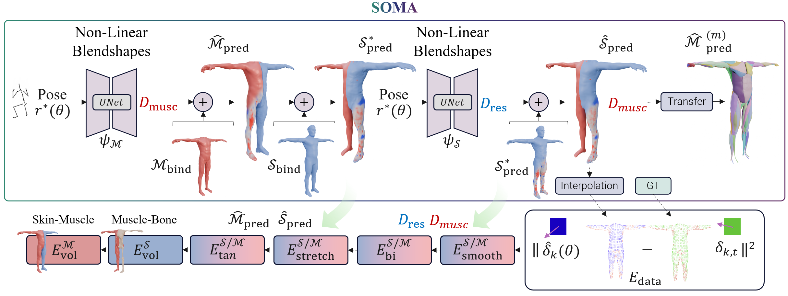
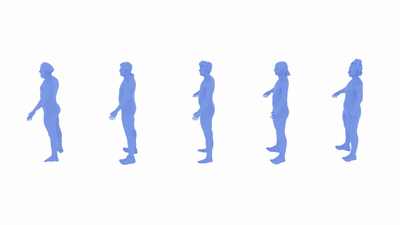
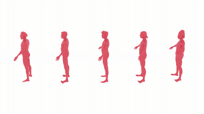
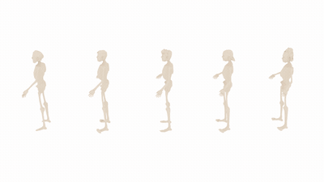

<div align="center">

## SOMA: From Surface Observations to Muscle Anatomy
**European Conference on Computer Vision (ECCV) 2026**

[Eduardo Alvarado](https://edualvarado.com/)<sup>1</sup>, [Emily Kim](https://kimemily12.github.io/publications/)<sup>1</sup>, [Gerrit Nolte](https://cg.cs.tu-dortmund.de/people/nolte_gerrit.html)<sup>2</sup>, [Friedemann Runte](https://cg.cs.tu-dortmund.de/people/runte_friedemann.html)<sup>2</sup>, [Mario Botsch](https://ls7-gv.cs.tu-dortmund.de/people/botsch_mario.html)<sup>2</sup>, [Marc Habermann](https://people.mpi-inf.mpg.de/~mhaberma/)<sup>1</sup>, [Christian Theobalt](https://people.mpi-inf.mpg.de/~theobalt/)<sup>1</sup>

<sup>1</sup> [Max Planck Institute for Informatics, Saarland Informatics Campus](https://www.mpi-inf.mpg.de/departments/visual-computing-and-artificial-intelligence) &nbsp;&nbsp; <sup>2</sup> [TU Dortmund University](https://www.tu-dortmund.de/en/)

[**Project page**](https://vcai.mpi-inf.mpg.de/projects/SOMA/) | [**Paper**](https://arxiv.org/abs/2606.09246) | [**Video**](https://youtu.be/4EWyj6Ew9aw) | [**Data**](https://gvv-assets.mpi-inf.mpg.de/soma)


</div>

---

## News

- **2026-10-20: SOMA v2 released.** SKIM V2 dataset (rebuilt rigs, fixed hands, poses and marker maps) and
  pretrained SOMA models for S1–S5 (`RELEASE_V2`, trained on SKIM V2). If you downloaded SKIM before, please
  download it again (see [Data Preparation](#data-preparation)).

## Abstract

With the growing demand for realistic virtual humans, parametric body models have become a
cornerstone of modern medicine, sports, and entertainment applications. However, most of
these models are inherently limited: they only capture the 3D surface of the skin, offering
no insight into the complex bio-mechanical structures that generate motion. Traditional
soft-tissue simulations, such as FEM, are accurate but non-scalable and too computationally
expensive for most common applications. Alternatively, existing biomechanical tools can
simulate muscular forces and activations, but do not model changes in external shape,
restricting how activations correlate with actual observable anatomy. This motivates a novel
inverse research problem: recovering muscle deformations directly from visible surface
observations — i.e., from the skin, and thus the pose. In this work, we present **SOMA**
(from **S**urface **O**bservations to **M**uscle **A**natomy), a person-specific model that
infers spatio-temporal muscle behavior from surface signals obtained using RGB cameras, and
**SKIM**, a subject-specific soft-tissue deformation dataset. To the best of our knowledge,
this is the first method that attempts to recover muscle deformations from multi-view RGB
data. We show how our method provides anatomically grounded animations without the complexity
of traditional simulations, leading to a scalable and cost-effective solution.

---

## Method

SOMA builds on the idea of pose-dependent corrective blendshapes, but extends them from a
single skin surface to a **volumetric, multi-layer anatomy**. Given a skeletal pose, two
cascaded non-linear U-Nets predict a muscle displacement field *D<sub>musc</sub>* that drives
the bulging of the underlying muscle layer, and a residual offset *D<sub>res</sub>* that lets
the skin slide and compress over the tissue instead of rigidly following the muscle. Because
recovering these layers from sparse surface markers alone is ambiguous, we supervise the
network with the canonical marker residuals from SKIM and regularize it with a set of
**biomechanically inspired priors**: area-normalized Laplacian smoothness and biharmonic
bending resistance, edge-stretching and tangential-sliding constraints, and a prism-based
volume-preservation term that enforces the near-incompressibility of soft tissue. Finally,
the learned boundary deformation is propagated to high-resolution individual muscle meshes
through a precomputed barycentric binding, yielding anatomically grounded, spatio-temporal
muscle animation directly from pose.

<div align="center">

</div>

---

## Results

<div align="center">
<table>
<tr>
<td></td>
<td></td>
<td></td>
<td></td>
</tr>
</table>
</div>

---

## SKIM Dataset (Skin-to-Internal Muscle)

Inferring internal muscle deformation from RGB video is inherently ill-posed, since only the
skin surface is observed. **SKIM** resolves this by pairing high-precision, temporally
consistent skin annotations with an individualized volumetric muscle template. Each of the
five subjects wears a custom skin-tight suit embedded with ArUco markers and is captured in a
120-camera markerless motion-capture studio, while a separate 140-camera scanner reconstructs
high-resolution static templates of the skin, muscle, and skeleton layers, together with
individual muscle meshes. Detected markers are unwrapped into a canonical point cloud, bound
to the underlying muscles, tracked across motion, and converted into pose-normalized residual
deformation fields that capture subject-specific soft-tissue dynamics. In total, SKIM provides
**45 minutes** of multi-view recordings with ground-truth skeletal poses, marker trajectories,
visibility masks, and the full multi-layer anatomy for each subject.

<div align="center">
<table>
<tr>
<td></td>
<td></td>
<td></td>
</tr>
</table>
</div>

---

## Repository structure

This repository contains the **source code** for the full pipeline, organized into sequential
stages; most stages have their own README. Bulk data (per-subject captures, model checkpoints,
Blender scenes, generated meshes) is **not** tracked — see [`.gitignore`](.gitignore).

| Stage | Directory | What it does | Docs |
|-------|-----------|--------------|------|
| 1 | `01-Suit-Processing/` | 2D detection, triangulation & 3D tracking of suit markers; suit manufacturing toolkit | [README](01-Suit-Processing/README.md) |
| 2 | `02-Canonical-Model/` | Build the canonical (rest-pose) marker model; UV marker detection & annotation | [README](02-Canonical-Model/README.md) |
| 3 | `03-Registration/` | Compute marker Linear Blend Skinning (LBS) weights against the canonical model | [README](03-Registration/README.md) |
| 5 | `05-Training/` | Train the deformation network on the SKIM data, validate, evaluate, visualize | [README](05-Training/README.md) |
| 6 | `06-Evaluation/` | Biomechanical evaluation (muscle/skin intersection, volume stability), SMPL alignment | [README](06-Evaluation/README.md) |

Alongside the numbered stages, **`Residuals-Python/`** holds the pure-Python residual pipeline (no
Blender) that produces the released **SKIM** dataset — marker residual regeneration, marker
relabeling, dataset finalization, and the Viser viewers.

**`Showcase/`** is a real-time Blender viewer of the individual muscle deformation (see its
[README](Showcase/README.md)).

---

## Quick Start

### Requirements
- **Python:** 3.9+
- **PyTorch:** install the build matching your CUDA toolkit — see the
  [official guide](https://pytorch.org/get-started/locally/).
- **Blender:** the visualization scripts `05-Training/A_`–`H_*.py` run **inside Blender** and use its
  built-in Python API (`bpy`, `mathutils`, `bmesh`, `gpu`); these are not pip packages.

### Installation

1. Clone this repository.
2. Create and activate a virtual environment:
     ```bash
     python -m venv env
     source env/bin/activate        # Windows: .\env\Scripts\activate
     ```
3. Install PyTorch according to your compute platform, **before** the other dependencies
   (otherwise `pip` may install the CPU-only build from PyPI, e.g. on Windows).
4. Install the remaining dependencies:
     ```bash
     pip install -r requirements.txt
     ```

> **Note:** versions in [`requirements.txt`](requirements.txt) are unpinned; the code was
> developed against a specific CUDA/PyTorch stack on a SLURM cluster. Pin as needed.

---

## Data Preparation

> **Current release: SKIM V2** (`metadata.json` → `dataset_version: 2`) together with the pretrained
> SOMA models in `SOMA_checkpoints.tar`, which were trained on it. If you downloaded SKIM before V2,
> please download it again: V2 fixes the rig, poses and marker maps of V1 (see the dataset README).

The per-subject SKIM data (subjects S1–S5) is released as a separate download (see **Data**
above) and is **not** included in this repository. The dataset is self-contained and
training-ready; per subject it provides:

- `<S>/canonical.npz` — canonical markers, bind markers, marker-LBS weights, joint names
- `<S>/shot_XXX.npz` — per-shot residuals (`residual_m` / `residual_scaled`), visibility mask,
  pose, and the per-shot rigid alignment
- `<S>/preprocessed_vFinal_clean/<shot>.npz` — packed, training-ready frames
  (`pose` `(F, J*6)`, `residuals` `(F, M, 3)`, `masks` `(F, M)`, `global_R` `(3, 3)`)
- `<S>/layers/{tpose,apose}/` — canonical skin / muscle / skeleton meshes
- `<S>/canonical_model/` — canonical markers, barycentric map, skin/muscle LBS weights, and the
  SOMA rig `<S>_rig.npz` (rest joints + skin weights). Its `individual_muscle_to_skin_binding.json` is
  superseded: its triangle indices do not match the released meshes, and the code binds the individual
  muscles to the muscle layer itself (`05-Training/muscle_binding.py`)
- `<S>/raw/<shot>_captury/<S>_<shot>.bvh` — per-shot motion (BVH)

It also ships a loader (`skim_loader.py`), two Viser viewers, and its own `README.md` /
`metadata.json` documenting every array and convention.

**To train, just point the scripts at the downloaded dataset**, either with the `SKIM_ROOT`
environment variable or the `--data-root` flag (the flag wins):

```bash
export SKIM_ROOT=/path/to/SKIM_dataset       # or: python <script>.py --data-root /path/to/SKIM_dataset
```

Every script resolves its inputs under `<root>/<S>/`. The data loader auto-detects the packed
per-shot `.npz`, so **no separate preprocessing step is required**. The
train/validation split holds out whole shots (~10 % of the frames) and is fixed per subject in
`05-Training/S{N}_validation_filepaths.json`.

The scripts that built the training tensors from the raw captures
(`00_preprocess_data.py`, `preprocess_from_skim.py`, `pack_preprocessed.py`) are included for
reproducibility only.

---

## Training

The defaults of [`05-Training/01_end_to_end_training.py`](05-Training/01_end_to_end_training.py) are the
released configuration (UNet, preset `soma_final`); one model is trained per subject. The architecture
(`--arch`: `linear`, `mlp`, `unet`) and loss weights (`LAMBDAS_PRESETS`, `--preset`) can be changed;
evaluate with the same architecture (`CONFIG["architecture"]` in `02_validate_training.py`, `--arch` for
`03_evaluate_metrics.py`). See [`05-Training/README.md`](05-Training/README.md).

```bash
cd 05-Training
python 01_end_to_end_training.py --subject S1 --epochs 40        # interactive
python sweep.py --only RELEASE_V2 --subjects S1,S2,S3,S4,S5 --epochs 40   # released models (train + evaluate)
# or, on a SLURM cluster (sbatch passes SKIM_ROOT through from your shell):
sbatch 01_end_to_end_training_job.sh --subject S1 --epochs 40
```

**Pretrained models** for S1–S5 (`RELEASE_V2`, trained on SKIM V2) ship with the dataset (`SOMA_checkpoints.tar`); extract it into
`05-Training/` (`tar -xf SOMA_checkpoints.tar -C 05-Training`).

> **Note:** retraining with `sweep.py --only RELEASE_V2` (or `--tag RELEASE_V2_e40`) writes the same file
> names and replaces the pretrained checkpoints in `checkpoints/`; use another `--tag` to keep both.

### Loss terms

| Loss | Key | Purpose |
|------|-----|---------|
| Data | `w_data` | Marker tracking via barycentric interpolation |
| Laplacian smoothness | `w_smooth_musc/skin` | Spatial coherence |
| Biharmonic energy | `w_biharmonic_musc/skin` | Second-order smoothness / wrinkle control |
| Spring energy | `w_spring_musc/skin` | Stretch resistance |
| Tangential energy | `w_tangent_musc/skin` | Prevent normal sliding |
| Volume preservation | `w_vol_musc/skin` | Prism volume loss (2-point Gauss quadrature) |
| Crease | `w_crease_musc/skin` | Penalize folds |
| Unobserved skin | `w_unobs` | Keep skin without markers close to LBS (along the normal) |

---

## Evaluation & Visualization

```bash
cd 05-Training
python 02_validate_training.py                    # viewer; subject/shot/checkpoint at the top of the script
python 03_evaluate_metrics.py --subject S1 --arch unet \
    --checkpoint checkpoints/S1_ABLATION_UNET_RELEASE_V2_e40_best_data.pth
```

`03_evaluate_metrics.py` reports SOMA's metrics on the held-out shots: marker error (MPME-obs, P90, τ),
muscle/fat intersections, volume variation and surface roughness. `06-Evaluation/` holds the scripts
used to evaluate the HIT baseline for comparison (see its [README](06-Evaluation/README.md)).
Visualization helpers are the `A_`–`H_` prefixed scripts in `05-Training/`. [`Showcase/`](Showcase/README.md)
plays the input motion and the resulting individual muscle deformation (posed and canonical) in real time in Blender.

---

## Citation

If you use this project in your research, please cite:

```bibtex
@inproceedings{alvaradosoma2026,
  author    = {Alvarado, Eduardo and Kim, Emily and Nolte, Gerrit and Runte, Friedemann and Botsch, Mario and Habermann, Marc and Theobalt, Christian},
  title     = {SOMA: From Surface Observations to Muscle Anatomy},
  booktitle = {European Conference on Computer Vision (ECCV)},
  year      = {2026},
}
```

---

## License

Released under the [MIT License](LICENSE).
